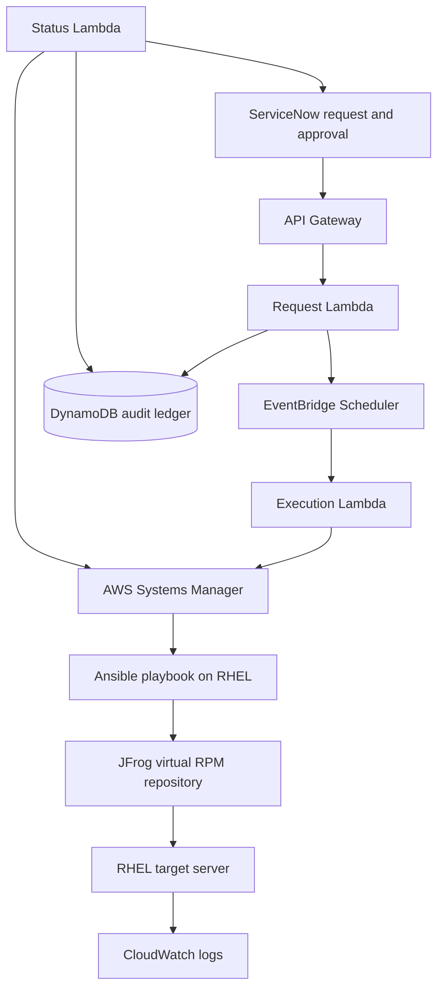

# Architecture

## Trust boundaries

| Boundary | Control |
|---|---|
| ServiceNow to AWS | HTTPS plus integration API key stored in Secrets Manager |
| AWS to RHEL | Systems Manager managed-node identity and IAM |
| RHEL to JFrog | HTTPS and a read-only repository credential |
| Developer to GitHub | Feature branch, pull request, and automated validation |

## Why Systems Manager runs Ansible

`AWS-ApplyAnsiblePlaybooks` downloads the versioned playbook bundle from S3 and
runs Ansible locally on the managed node. This avoids a permanent Ansible
controller and inbound automation SSH while retaining readable, idempotent
Ansible automation.

